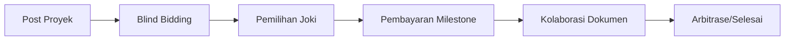

# Joki Skripsi — Product Requirements Document (PRD)
- Document Version: v7.0
- Date: 2026-11-23
- Author: AI Principal Product Architect
- Status: Ready for Development & Implementation (Revised)
- Decisions Synthesized: 129 Confirmed Architectural Decisions
- Catatan Revisi: Seksi 10, 22 (Di Third Party bagian Payment Gateway saya tidak ingin itu ke midrtrans/xendit s)

---

## 1. Project Overview
"Joki Skripsi" adalah platform marketplace terkurasi yang dirancang untuk menjembatani kesenjangan kepercayaan antara mahasiswa tingkat akhir dan penyedia jasa penulisan akademik. Platform ini mengadopsi model *Curated Marketplace* di mana setiap penyedia jasa (Joki) wajib melalui proses verifikasi KYC dan uji kompetensi manual. Proyek ini hadir sebagai solusi atas ketiadaan standar keamanan dalam transaksi jasa penulisan akademik yang saat ini didominasi oleh transaksi informal berisiko tinggi.

Model bisnis kami berfokus pada **Komisi per Transaksi** yang aman dan transparan. Proposisi nilai utama (UVP) kami adalah **"Safe-Haven Transaction"**, yang diwujudkan melalui sistem Escrow (Rekber) terintegrasi dan jaminan anti-plagiarisme. Dengan arsitektur *Mobile-First Web App*, platform ini memastikan setiap progres penulisan dapat dipantau, divalidasi, dan dijamin secara profesional.

---

## 2. Product Vision & Objectives
**Visi:** Menjadi ekosistem marketplace layanan akademik paling tepercaya di Indonesia yang menjunjung tinggi standar kualitas profesional dan keamanan transaksi.

**Tujuan Strategis:**
1. **Keamanan Transaksi:** Mencapai 0% kasus penipuan dana melalui sistem Escrow (Rekber) terintegrasi.
2. **Kualitas Layanan:** Menjamin minimal 90% tingkat kepuasan pengguna melalui verifikasi KYC dan uji kompetensi/portofolio penyedia jasa.
3. **Efisiensi Operasional:** Mengurangi durasi resolusi sengketa hingga di bawah 48 jam melalui mekanisme *Admin-Mediated Arbitration*.
4. **Kepercayaan Pengguna:** Membangun ekosistem transparan melalui sistem rating, review, dan progres draf yang dapat diakses secara *real-time*.

---

## 3. Problem Statement
1. **Risiko Penipuan Tinggi:** Mahasiswa sering menjadi korban *scam* oleh penyedia jasa yang menghilang setelah menerima pembayaran penuh tanpa memberikan output.
2. **Kualitas Tidak Terstandarisasi:** Tidak adanya mekanisme validasi kompetensi menyebabkan mahasiswa menerima draf skripsi berkualitas rendah atau terdeteksi plagiarisme tinggi.
3. **Absennya Transparansi:** Ketiadaan model pembayaran bertahap (*Milestone*) membuat mahasiswa kehilangan daya tawar (bargaining power) setelah pembayaran dilakukan.
4. **Masalah Akses & Privasi:** Pertukaran dokumen melalui kanal chat tidak resmi (WhatsApp/Email) berisiko kebocoran data dan kehilangan jejak revisi.

---

## 4. Target Audience & User Personas
| Atribut | Persona A: Mahasiswa (Buyer) | Persona B: Joki (Seller) |
| :--- | :--- | :--- |
| **Bio** | Mahasiswa S1 akhir, stres dengan deadline. | Akademisi/Freelancer, ahli di bidangnya. |
| **Pain Points** | Takut tertipu, butuh jaminan kualitas. | Sering tidak dibayar, klien tidak kooperatif. |
| **Goals** | Skripsi selesai & lolos revisi. | Pendapatan stabil & reputasi profesional. |
| **Tech Savvy** | Tinggi (Mobile-first). | Tinggi (Terbiasa alat kolaborasi/dokumentasi). |

---

## 5. Scope & Project Boundaries
| Kategori | In Scope | Out of Scope | Alasan |
| :--- | :--- | :--- | :--- |
| **Fitur** | Blind Bidding, Escrow, KYC | AI Writing Generator | Menjaga integritas human-expertise. |
| **Pembayaran** | Milestone-based | Transfer Langsung/Manual | Menghindari *bypass* sistem Escrow. |
| **Verifikasi** | KTP + Portofolio | Jasa Joki Tes/Ujian | Menjaga legalitas & etika. |
| **Dokumen** | Portal Enkripsi File | Jasa Cetak/Jilid | Fokus pada platform digital. |

---

## 6. Functional Requirements (MoSCoW)
| Kode | Nama Fitur | Deskripsi | Role | Prioritas |
| :--- | :--- | :--- | :--- | :--- |
| FR-01 | KYC Verification | Verifikasi KTP & Selfie | Joki | Must |
| FR-02 | Blind Bidding | Penawaran harga tersembunyi | Joki | Must |
| FR-03 | Escrow System | Rekber (Dana ditahan) | All | Must |
| FR-04 | Milestone Payment | Bayar per bab/progres | All | Must |
| FR-05 | Admin Arbitration | Mediasi sengketa | Admin | Must |
| FR-06 | Chat Real-time | Komunikasi terenkripsi | All | Must |
| FR-07 | Document Portal | Drag-and-drop & Preview | All | Must |
| FR-08 | Rating & Review | Ulasan setelah proyek | Buyer | Should |
| FR-09 | Guided Wizard | Posting kebutuhan skripsi | Buyer | Must |
| FR-10 | Notifikasi WA | Update status transaksi | All | Must |
| FR-11 | Audit Logs | Catatan status transaksi | Admin | Must |
| FR-12 | RLS Protection | Isolasi data antar user | System | Must |
| FR-13 | Portfolio Show | Galeri portofolio joki | Joki | Should |
| FR-14 | Dashboard Stats | Progres skripsi visual | Buyer | Should |
| FR-15 | Anti-Plagiarisme | Integrasi cek plagiarisme | System | Could |

---

## 7. Non-Functional Requirements
*   **Latency:** API response < 200ms untuk operasional UI.
*   **Availability:** Uptime SLA 99.9% (Vercel Edge Network).
*   **Keamanan:** Enkripsi file AES-256 (storage) + RLS (database).
*   **Concurrency:** Mendukung hingga 5.000 user aktif bersamaan.
*   **Integrity:** Immutable Audit Logs untuk setiap perubahan status transaksi.

---

## 8. User Roles & Permission Matrix
| Fitur | Mahasiswa | Joki | Admin |
| :--- | :---: | :---: | :---: |
| Posting Proyek | CRUD | Read | Read |
| Bidding | No | Create | No |
| Release Payment | Yes | No | Yes |
| Dispute Management | Yes | Yes | Yes |
| KYC Approval | No | No | Full Access |

---

## 9. User Journey & Workflow
1. **Registrasi:** OAuth Google & 2FA WhatsApp.
2. **Posting:** Mahasiswa menggunakan *Guided Wizard* (Jurusan, Deadline, Topik, Draf).
3. **Bidding:** Joki melakukan *Blind Bidding* dalam batas waktu.
4. **Assignment:** Mahasiswa memilih Joki (Review Profil/Rating).
5. **Execution:** Kolaborasi dokumen & Chat.
6. **Milestone:** Dana dilepas per progres draf.
7. **Settlement:** Rating diberikan, dana diteruskan ke Joki.



---

## 10. Business Logic & Validation Rules

Seksi ini mendefinisikan aturan bisnis inti, batasan validasi, dan alur state-machine yang menggerakkan sistem marketplace "Joki Skripsi". Seluruh logika ini diimplementasikan menggunakan kombinasi *Supabase Database Functions* (PostgreSQL) dan *Next.js Server Actions* untuk memastikan *single source of truth*.

### 10.1. State Machine: Project Lifecycle
Setiap proyek mengikuti alur status yang kaku untuk memastikan integritas data dan transparansi.

| Status | Deskripsi | Transisi yang Diizinkan |
| :--- | :--- | :--- |
| `DRAFT` | Proyek baru dibuat, belum dipublikasi. | `OPEN` |
| `OPEN` | Terbuka untuk menerima bid dari Joki. | `BIDDING` |
| `BIDDING` | Proses Blind Bidding berlangsung. | `IN_PROGRESS` |
| `IN_PROGRESS` | Pekerjaan sedang dilakukan (Escrow Terkunci). | `REVIEW` |
| `REVIEW` | Menunggu konfirmasi milestone dari Mahasiswa. | `COMPLETED`, `DISPUTED` |
| `COMPLETED` | Pekerjaan selesai, dana dilepas ke Joki. | - |
| `DISPUTED` | Sengketa aktif, dana dibekukan, Admin intervensi. | `COMPLETED`, `REFUNDED` |

### 10.2. Mekanisme Blind Bidding
Untuk menjaga kompetisi yang sehat dan mencegah kolusi harga, sistem menerapkan *Blind Bidding*:
*   **Isolasi Informasi:** Bid joki bersifat privat. Joki tidak dapat melihat `bid_amount` atau `proposal_text` dari kompetitor.
*   **One-Shot Rule:** Setiap joki hanya diizinkan mengajukan **satu kali bid** per proyek.
*   **Validation Constraint:** `bid_amount` harus > 0 dan tidak boleh melebihi 200% dari `budget_range` yang ditetapkan mahasiswa untuk menghindari spam bid.

### 10.3. Custom Payment Gateway (Direct Settlement)
Sesuai dengan kebijakan arsitektur, platform tidak menggunakan pihak ketiga (seperti Midtrans/Xendit) untuk settlement. Pembayaran dikelola secara langsung melalui integrasi perbankan/VA yang terhubung ke rekening penampungan internal perusahaan.

*   **Flow Escrow Direct:**
    1.  Mahasiswa melakukan transfer nominal ke rekening operasional perusahaan.
    2.  Sistem melakukan verifikasi mutasi melalui *Webhook Banking API* (atau input manual oleh Admin dengan validasi bukti transfer).
    3.  `escrow_status` diperbarui menjadi `HELD` setelah sinkronisasi saldo.
    4.  Dana tidak dapat ditarik oleh Joki hingga `Milestone` status adalah `APPROVED`.
*   **Keamanan Transaksi:**
    *   Setiap transaksi wajib mencantumkan `unique_payment_code` (3 digit terakhir nominal) untuk rekonsiliasi otomatis.
    *   **Audit Log:** Setiap perubahan pada `escrow_status` wajib mencatat `actor_id`, `timestamp`, dan `transaction_ref` ke dalam tabel `audit_logs`.

### 10.4. Validasi Milestone & Arbitrase
Sistem *Milestone* bertindak sebagai pemicu pelepasan dana bertahap.
*   **Approval Window:** Jika Mahasiswa tidak memberikan aksi (Approve/Reject) dalam `3x24 jam` setelah Joki mengajukan `Milestone Submission`, sistem akan mengirimkan notifikasi eskalasi via WhatsApp.
*   **Arbitration Trigger:** Jika setelah eskalasi (total `5x24 jam`) tidak ada respon, status secara otomatis berubah menjadi `DISPUTED` dan masuk ke antrean Admin.
*   **Admin Intervention:** Admin memiliki hak akses penuh untuk memaksa status:
    *   `Force Release`: Jika bukti pekerjaan valid.
    *   `Force Refund`: Jika terjadi pelanggaran berat atau kegagalan penyelesaian.

### 10.5. Skema DDL SQL (Core Validation)
```sql
-- Validasi Bid: Mencegah multiple bid oleh user yang sama pada project yang sama
CREATE UNIQUE INDEX idx_unique_bid_per_user_project 
ON biddings (project_id, joki_id);

-- Validasi Escrow: Memastikan dana tidak bisa ditarik jika status belum completed
ALTER TABLE milestones ADD CONSTRAINT check_milestone_payout 
CHECK (
  (status = 'PAID' AND project_status = 'COMPLETED') OR (status != 'PAID')
);

-- Audit Log Table untuk kepatuhan operasional
CREATE TABLE audit_logs (
    id UUID PRIMARY KEY DEFAULT uuid_generate_v4(),
    entity_type TEXT NOT NULL, -- 'ESCROW', 'MILESTONE', 'BID'
    entity_id UUID NOT NULL,
    action TEXT NOT NULL,
    actor_id UUID REFERENCES users(id),
    previous_state JSONB,
    new_state JSONB,
    created_at TIMESTAMP WITH TIME ZONE DEFAULT NOW()
);
```

### 10.6. API Endpoint Validation (Server Actions)
Setiap permintaan perubahan status harus divalidasi di sisi server (Next.js Server Actions):

```typescript
// Contoh validasi Server Action untuk pengajuan bid
export async function submitBid(projectId: string, amount: number, proposal: string) {
  const user = await getAuthenticatedUser();
  
  // 1. Validasi Role
  if (user.role !== 'JOKI') throw new Error("Unauthorized");
  
  // 2. Validasi Status Proyek
  const project = await db.project.findUnique({ where: { id: projectId } });
  if (project.status !== 'OPEN') throw new Error("Bidding closed");
  
  // 3. Validasi One-Shot Bid
  const existingBid = await db.bidding.findFirst({ where: { projectId, jokiId: user.id } });
  if (existingBid) throw new Error("You have already submitted a bid");

  // 4. Proses Transaksi
  return await db.bidding.create({ data: { projectId, jokiId: user.id, amount, proposal } });
}
```

### 10.7. Mitigasi Risiko Operasional (Business Logic)
*   **Anti-Plagiarism Lock:** Joki wajib mengunggah *plagiarism report* (misal: Turnitin) sebelum milestone dapat diserahkan. Sistem akan memvalidasi keberadaan file tersebut dalam `document_portal`.
*   **KYC Enforcement:** Joki tidak diizinkan membuat proposal jika `kyc_status` belum `VERIFIED` oleh Admin.
*   **Rate Limiting:** Setiap aksi `submitBid` dibatasi maksimal 5 permintaan per jam per user untuk mencegah bot scraping harga.

---

## 11. UI/UX Design Direction
Filosofi desain **"Modern Academic Professional"** bertujuan menciptakan rasa percaya (trust) dan otoritas.
*   **Visual Language:** Menghindari estetika *gig-economy* yang terlalu ramai. Menggunakan *whitespace* yang luas untuk mengurangi beban kognitif saat meninjau dokumen skripsi yang kompleks.
*   **Hierarki Informasi:** Menggunakan *Progressive Disclosure*—detail teknis (seperti log perubahan file) disembunyikan di balik *expandable cards*.
*   **Trust-Building:** Badge verifikasi KYC diletakkan tepat di samping nama profil untuk memvalidasi kredibilitas penyedia jasa secara instan.

---

## 12. Design System & Component Guidelines

| Kategori | Token | Value / Spesifikasi |
| :--- | :--- | :--- |
| **Colors** | Primary | Forest Green (#1B4332) |
| | Secondary | Deep Burgundy (#581845) |
| | Background | Off-White (#F8F9FA) |
| | Surface | White (#FFFFFF) |
| **Typography** | Headings | 'Playfair Display' (Serif) |
| | Body | 'Inter' (Sans-Serif) |
| **Spacing** | Base | 4px (Grid: 4, 8, 16, 24, 32, 48, 64) |
| **Border** | Radius | 8px (Small), 12px (Medium), 24px (Large) |

---

## 13. Page-by-Page UI Specifications
1.  **Dashboard (Progress View):** Card-based layout menampilkan status *Milestone* dengan *Visual Progress Bar*.
2.  **Bidding Portal:** Tabel dinamis dengan filter (Deadline, Budget, Jurusan). *Empty state* menggunakan ilustrasi minimalis "No active bids".
3.  **Chat Interface:** Integrasi *real-time* dengan *timestamp* dan indikator status baca.
4.  **Document Portal:** *Drag-and-drop* area dengan *file-preview* (PDF/DOCX) terintegrasi.
5.  **Settings/KYC:** Form multi-step dengan *feedback* instan saat upload dokumen identitas.

---

## 14. Responsive Design Specifications
*   **Desktop (>=1280px):** Sidebar navigasi permanen, layout 3-kolom untuk manajemen proyek.
*   **Tablet (768-1024px):** Layout 2-kolom, navigasi berubah menjadi *collapsible drawer*.
*   **Mobile (<768px):** Bottom navigation bar, elemen kartu disusun vertikal, modal untuk input data intensif.

---

## 15. System Architecture
*   **Frontend:** Next.js (App Router) + Server Actions.
*   **Backend:** Supabase (PostgreSQL) + Edge Functions (Node.js).
*   **Real-time:** Supabase Realtime (WebSockets) untuk chat.
*   **Storage:** Supabase Storage (S3-compatible) dengan Signed URLs.

---

## 16. Technology Stack
| Layer | Tech | Justifikasi |
| :--- | :--- | :--- |
| **Frontend** | Next.js 14 | SSR/SSG untuk SEO & performa. |
| **Database** | PostgreSQL | Relasional, mendukung RLS untuk keamanan data. |
| **Auth** | Supabase Auth | Google OAuth & 2FA WhatsApp. |
| **Styling** | Tailwind CSS | Utility-first untuk Design System. |
| **Validation** | Zod | Type-safety end-to-end. |

---

## 17. Database Schema & Relationships (DDL SQL)
```sql
-- Core Tables
CREATE TABLE profiles (
  id UUID PRIMARY KEY REFERENCES auth.users,
  is_verified BOOLEAN DEFAULT FALSE,
  role TEXT CHECK (role IN ('buyer', 'seller'))
);

CREATE TABLE projects (
  id UUID PRIMARY KEY DEFAULT gen_random_uuid(),
  buyer_id UUID REFERENCES profiles(id),
  status TEXT DEFAULT 'open', -- draft, open, bidding, in_progress
  budget_range NUMERIC,
  deadline TIMESTAMP
);

CREATE TABLE milestones (
  id UUID PRIMARY KEY,
  project_id UUID REFERENCES projects(id),
  amount NUMERIC,
  status TEXT DEFAULT 'pending' -- pending, held, released
);

-- Row Level Security
ALTER TABLE projects ENABLE ROW LEVEL SECURITY;
CREATE POLICY "Users can only view their own projects" ON projects 
FOR SELECT USING (auth.uid() = buyer_id);
```

---

## 18. API Specifications (REST)
| Method | Endpoint | Auth | Deskripsi |
| :--- | :--- | :--- | :--- |
| POST | `/api/bids` | JWT | Kirim proposal bidding |
| GET | `/api/projects` | JWT | List proyek tersedia |
| POST | `/api/escrow/release` | Admin | Lepas dana milestone |

---

## 19. Authentication & Authorization
*   **Google OAuth:** Akses primer.
*   **JWT Rotation:** *Refresh token* disimpan di *HttpOnly Cookie* dengan rotasi setiap 15 menit untuk mencegah *session hijacking*.
*   **2FA:** Verifikasi WhatsApp via Twilio API setelah login pertama.

---

## 20. Security Architecture & OWASP Compliance
| Ancaman | Mitigasi |
| :--- | :--- |
| **SQLi** | Penggunaan Supabase PostgREST (Parameterized queries). |
| **Broken Access Control** | Implementasi RLS pada 100% tabel database. |
| **Sensitive Data Exposure** | Enkripsi file di storage dengan Signed URLs (expiry 1 jam). |
| **Rate Limiting** | Implementasi Vercel Edge Rate Limiter (20 req/min). |
| **CORS** | Strict policy hanya untuk domain `*.jokiskripsi.com`. |

---

Berikut adalah **Bagian 3: Spesifikasi Teknis Mendalam (Seksi 21-29)** untuk platform "Joki Skripsi".

---

## 21. Error Handling & Edge Cases
Sistem menerapkan standarisasi respon error (RFC 7807) untuk memastikan konsistensi frontend.

*   **Standard Error Schema:**
    ```json
    { "error": { "code": "ERR_CODE", "message": "Human readable message", "details": {}, "trace_id": "uuid" } }
    ```
*   **Edge Cases:**
    *   **Bidding Collision:** Jika dua penyedia jasa menawar di detik yang sama, sistem menggunakan *Optimistic Locking* (versioning pada tabel `bidding`) untuk mencegah *race condition*.
    *   **Network Interruption:** Implementasi *Exponential Backoff* pada *Client-side SDK* (Supabase/Axios).
    *   **File Upload Failure:** Jika koneksi terputus, *chunked upload* dengan *resume capability* digunakan untuk dokumen skripsi.
    *   **Human Error:** Implementasi "Soft Delete" untuk pembatalan proyek agar data tetap tersedia untuk audit administratif.

---

## 22. Third-Party Integrations

Seksi ini mendefinisikan integrasi eksternal yang diperlukan untuk mendukung operasional platform "Joki Skripsi". Sesuai dengan instruksi arsitektural, sistem pembayaran diubah dari *third-party payment gateway* (seperti Midtrans/Xendit) menjadi sistem **Direct Settlement (Direct-to-Owner)** untuk kendali penuh atas arus kas dan eliminasi biaya administrasi pihak ketiga.

### 22.1. Payment Settlement (Direct-to-Owner)
Untuk menjaga kedaulatan finansial, sistem tidak menggunakan *gateway* eksternal untuk proses *checkout*. Pengguna (Mahasiswa) melakukan transfer langsung ke rekening operasional perusahaan/platform. Verifikasi dilakukan melalui integrasi *Proof-of-Payment* yang divalidasi oleh sistem atau admin.

*   **Flow Pembayaran:**
    1.  **Initiation:** Mahasiswa melakukan *Request Release Payment* pada *Milestone* tertentu.
    2.  **Instruction:** Sistem menampilkan data rekening tujuan (Bank/E-Wallet) milik pemilik platform.
    3.  **Submission:** Mahasiswa mengunggah bukti transfer (image/pdf) melalui *Document Portal*.
    4.  **Verification:** Admin melakukan verifikasi manual terhadap mutasi rekening (via API Bank atau *dashboard banking*).
    5.  **Settlement:** Admin mengubah status `escrow_status` menjadi `released` melalui *Admin Dashboard*, yang memicu notifikasi kepada Penyedia Jasa.

*   **Tabel: Skema Data Verifikasi Pembayaran**
| Field | Tipe Data | Deskripsi |
| :--- | :--- | :--- |
| `payment_id` | UUID | Primary Key |
| `project_id` | UUID | Foreign Key ke tabel Project |
| `milestone_id` | UUID | Foreign Key ke tabel Milestone |
| `transfer_ref` | VARCHAR | Nomor referensi bukti transfer mahasiswa |
| `payment_proof_url`| TEXT | Signed URL ke Supabase Storage |
| `verification_status`| ENUM | `pending`, `verified`, `rejected` |
| `admin_notes` | TEXT | Catatan jika verifikasi ditolak |

### 22.2. Messaging (WhatsApp API - Wablas)
Integrasi WhatsApp digunakan sebagai kanal notifikasi *real-time* untuk urgensi tinggi, mengingat target audiens adalah mahasiswa yang memiliki mobilitas tinggi.

*   **Provider:** Wablas (atau penyedia API WhatsApp Gateway sejenis).
*   **Event Trigger:**
    *   **Bidding Alert:** Notifikasi ke Mahasiswa saat ada bid baru masuk.
    *   **Milestone Update:** Notifikasi ke kedua pihak saat progres di-*update*.
    *   **Deadline Reminder:** Pengingat otomatis 24 jam sebelum tenggat waktu.
*   **Security:** Menggunakan *API Key* yang disimpan di `process.env.WHATSAPP_API_KEY` dengan enkripsi *server-side*.

### 22.3. Document Management (Supabase Storage)
Integrasi penyimpanan dokumen skripsi menggunakan Supabase Storage dengan kebijakan *Row Level Security* (RLS).

*   **Security Mechanism:**
    *   **Signed URLs:** Masa berlaku (TTL) dibatasi maksimal 15 menit untuk mencegah akses ilegal atau *leaking* dokumen skripsi.
    *   **Private Buckets:** Dokumen hanya dapat diakses oleh `user_id` yang memiliki relasi aktif pada `project_id` tersebut.
*   **Kode Implementasi (Next.js Server Action):**
```typescript
export async function getSecureDocumentUrl(path: string) {
  const { data, error } = await supabase.storage
    .from('skripsi-docs')
    .createSignedUrl(path, 900); // 15 menit TTL

  if (error) throw new Error('Akses dokumen ditolak');
  return data.signedUrl;
}
```

### 22.4. Webhook Lifecycle (Internal)
Karena pembayaran dilakukan secara *Direct-to-Owner*, sistem menggunakan *Internal Webhook* untuk mensinkronisasi status.

*   **Endpoint:** `POST /api/webhooks/payment-settlement`
*   **Payload:**
```json
{
  "project_id": "uuid",
  "milestone_id": "uuid",
  "action": "verify_payment",
  "admin_id": "uuid",
  "status": "success"
}
```
*   **Logika Atomik:** Setiap *trigger* akan menjalankan *SQL Transaction* untuk memastikan `escrow_status` berubah menjadi `released` bersamaan dengan pembuatan entri di `audit_logs` untuk transparansi sengketa di masa depan.

### 22.5. Ringkasan Integrasi
| Layanan | Provider | Fungsi | Keamanan |
| :--- | :--- | :--- | :--- |
| **Pembayaran** | Direct-to-Owner | Settlement Dana | Manual Verification + Audit Log |
| **Messaging** | Wablas | Notifikasi Urgent | API Key Rotation |
| **Storage** | Supabase | Dokumen Skripsi | RLS + 15m Signed URLs |
| **Logging** | Supabase | Audit Log | Read-only Admin Access |

---

## 23. Performance & Scalability
*   **Caching:** *Vercel Edge Caching* untuk data publik (Profil Joki, FAQ).
*   **Database:** *Connection Pooling* via Supabase (PgBouncer) untuk menangani hingga 1000+ *concurrent connections*.
*   **Optimasi Query:** *Indexing* pada kolom `project_id`, `user_id`, dan `status`. Penggunaan `JSONB` untuk data dinamis guna menghindari *schema migration* yang berat.
*   **Asset:** *Next.js Image Optimization* dan *Lazy Loading* untuk semua aset profil penyedia jasa.

---

## 24. SEO & Accessibility
*   **SEO:** *Server-Side Rendering (SSR)* untuk halaman detail proyek agar terindeks. Penggunaan `metadata` dinamis untuk OpenGraph (Title, Description, Image).
*   **Accessibility (WCAG 2.1 AA):**
    *   Kontras warna minimal 4.5:1 (Sesuai tema *Academic Excellence*).
    *   *Semantic HTML* (`<main>`, `<nav>`, `<article>`).
    *   *ARIA Labels* untuk elemen interaktif (Tombol Bidding, Progress Bar).

---

## 25. Testing Strategy
| Jenis Tes | Tools | Fokus |
| :--- | :--- | :--- |
| **Unit Testing** | Jest | Logika kalkulasi harga & milestone. |
| **Integration** | Supertest | API Flow (Auth -> Bidding -> Payment). |
| **E2E** | Playwright | User Journey penuh dari Posting hingga Selesai. |
| **Security** | OWASP ZAP | Pentest pada RLS dan SQL Injection. |

---

## 26. Acceptance Criteria (Gherkin Format)
1.  **Scenario: Mahasiswa Posting Proyek**
    *   *Given* user terautentikasi sebagai Mahasiswa
    *   *When* mengisi wizard posting dengan data valid
    *   *Then* sistem membuat record `project` dengan status `open`
2.  **Scenario: Joki Melakukan Bidding**
    *   *Given* proyek berstatus `open`
    *   *When* joki mengirimkan proposal bidding
    *   *Then* sistem mencatat record di `bidding` dan memicu notifikasi WA
3.  **Scenario: Pembayaran Milestone**
    *   *Given* proyek status `in_progress`
    *   *When* user menekan tombol 'Approve Milestone'
    *   *Then* dana escrow dilepas ke saldo joki secara proporsional
4.  **Scenario: Sengketa (Dispute)**
    *   *Given* proyek status `in_progress`
    *   *When* salah satu pihak mengajukan dispute
    *   *Then* sistem membekukan dana escrow dan notifikasi admin
5.  **Scenario: Keamanan Dokumen**
    *   *Given* user bukan pemilik dokumen
    *   *When* mengakses URL dokumen
    *   *Then* sistem menolak dengan 403 Forbidden via RLS

---

## 27. Deployment & Environment Configuration
*   **Environment Variables:** `DATABASE_URL`, `NEXT_PUBLIC_SUPABASE_URL`, `SUPABASE_SERVICE_ROLE_KEY`, `MIDTRANS_SERVER_KEY`, `WA_API_KEY`.
*   **CI/CD:** GitHub Actions -> *Run Lint/Test* -> *Build* -> *Deploy to Vercel*.
*   **Deployment:** *Blue-Green Deployment* untuk meminimalisir *downtime* saat update fitur.

---

## 28. Risks, Assumptions & Dependencies
| Risiko | Dampak | Mitigasi |
| :--- | :--- | :--- |
| Kebocoran Data Skripsi | Tinggi | Enkripsi AES-256 di Storage & RLS ketat. |
| Dispute Pembayaran | Sedang | Admin-Mediated Arbitration (SOP manual). |
| Kualitas Joki Rendah | Tinggi | Verifikasi KYC & Uji Portofolio Wajib. |

---

## 29. Development Roadmap & Milestones
*   **Sprint 1 (Foundation):** Setup Database (Supabase), Auth (Google OAuth), & UI Base (Design System).
*   **Sprint 2 (Core Logic):** Implementasi Wizard Posting, Blind Bidding, & Chat Real-time.
*   **Sprint 3 (Financials & Security):** Integrasi Escrow, Payment Gateway, & RLS (Security Hardening).
*   **Sprint 4 (Refinement):** Dashboard Progress, Notifikasi WA, & User Acceptance Testing (UAT).
